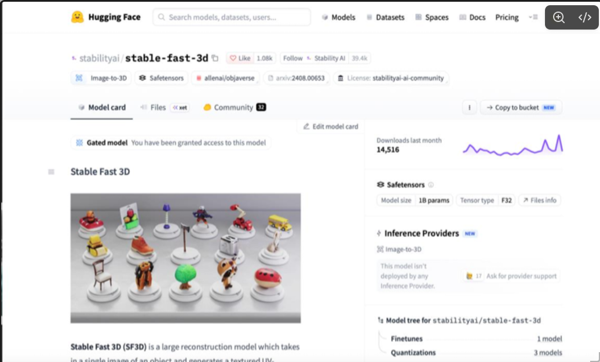

# Modelos 3D Stabiliy AI-3D

> Subes una imagen, la IA lo transforma en un objeto 3D .obj

**Proyecto integrador · Herramientas de IA**

**Grupo: A1** · **Equipo: 2**

## 👥 Integrantes

| Nombre completo | Matrícula |
|-----------------|-----------|
| Carlos Eduardo Lozano Delgadillo | 198274-4 |
| Jonathan Gael Arteaga Martinez | 198258-2  |
| Oscar Iván Cruz Villa  | 198591-4 |
|Jorge Santiago Juárez Oliva|198674-9|

## 1. Caso de uso
   ## 🔀 Cómo funciona
   ```mermaid
   flowchart LR
   A([Inserta imagen]) --[Stability AI]--> B[Renderiza] ===> C((Regresa .OBJ))
   ```
   
   

¿Qué necesidad resuelven y de quién es?
**Arquitectura** y **Diseño** de Interiores

Reconstrucción espacial y de mobiliario a partir de planos o fotos conceptuales.  Renderizar muebles personalizados dibujados por un cliente e integrarlos en la maqueta 3D de una vivienda.

- **Entrada:** imagen en .jpg
- **Salida:** Modelo en 3D .obj

## 2. Modelo abierto elegido

| Dato | Respuesta |
|------|-----------|
| Identificador | [Stabilityai / stable-fast-3d ](https://huggingface.co/stabilityai/stable-fast-3d) |
| Tarea | Este modelo esta entrenado para generar un  plano 3D desde una imagen.  |
| Número de parámetros | FP32 / 1B  |
| Licencia |stabilityai-ai-community |
| Limitación o sesgo declarado |El modelo no fue entrenado para ser representaciones fácticas o verdaderas de personas o eventos. Como tal, el uso del modelo para generar dicho contenido está fuera del alcance de las capacidades de este modelo.

## 3. Viabilidad de hardware

$$
\text{Memoria mínima} = 1,000,000,000 \times 4\ \text{bytes} \approx \ 4\ \text{GB}
$$

- **VRAM disponible en Colab:** 15 GB (GPU T4)
- **Dónde se ejecuta:** Colab
- **Por qué:** Porque se cubren los GB VRAM necesarios para correr el programa

## 4. Riesgo ético

- **Riesgo:** Podrian clonar a personas con una foto suya y convertirlas a 3D
- **Mitigación:**  podriamos mitigarlo haciendo que si la IA reconoce a un humano, no deje modelarlo.

## 5. Evidencia

